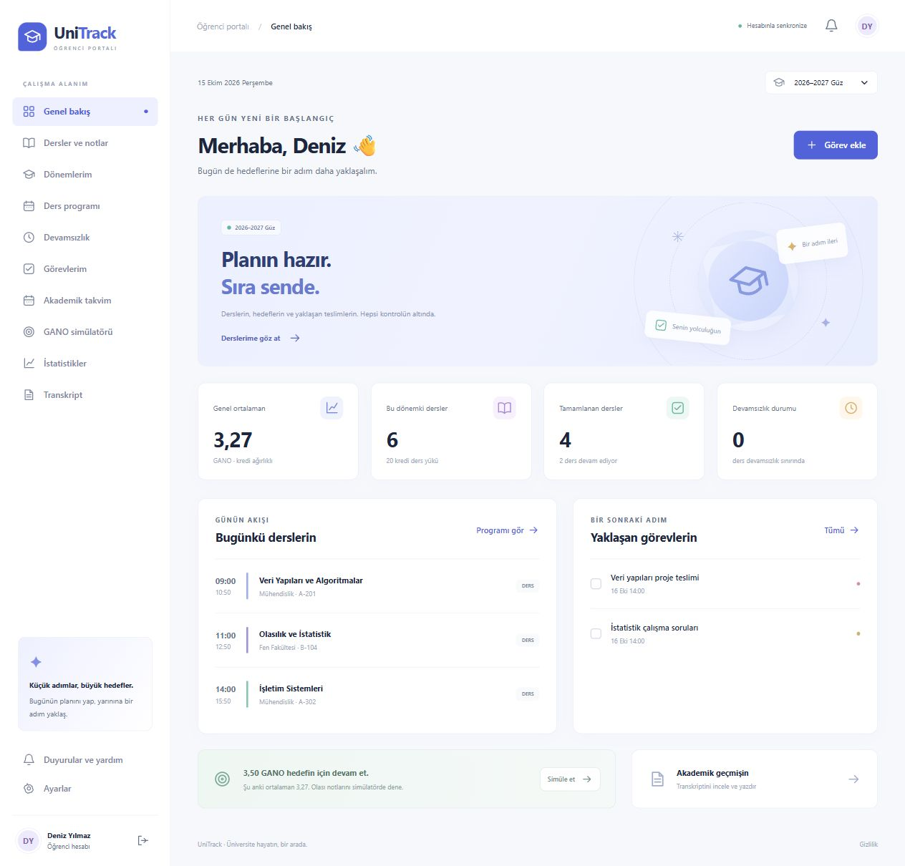
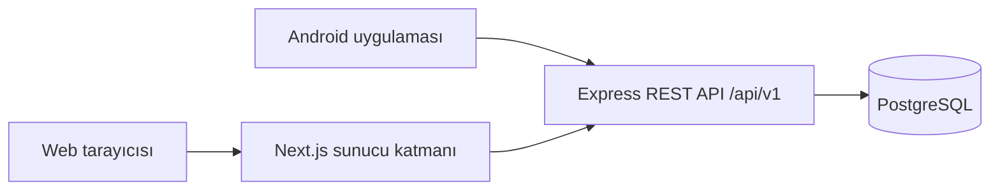

# UniTrack

Üniversite hayatını tek yerden takip et: dersler, notlar, devamsızlık, görevler ve akademik takvim.

UniTrack, Android uygulaması ve web öğrenci portalını ortak bir REST API üzerinde birleştirir. Aynı hesapla giriş yaparak iki platformda da derslerine ve akademik verilerine ulaşabilirsin.

[Web portalı](./web/README.md) · [Backend kurulumu](./backend/README.md) · [Android kurulumu](./android/README.md)



_Ekran görüntüsü örnek test verileriyle hazırlanmıştır. [Mobil web görünümü](./docs/images/student-portal-mobile.jpg)._

## Özellikler

| Alan                  | Neler yapabilirsin?                                                                                     |
| --------------------- | ------------------------------------------------------------------------------------------------------- |
| Dersler ve notlar     | Dönemleri ve dersleri yönet; kredi, ağırlıklı not bileşenleri ve harf notu skalası tanımla.             |
| Akademik planlama     | Haftalık ders programını, sınavlarını, etkinliklerini ve alt görevlerini takip et.                      |
| Devamsızlık           | Katılım, devamsızlık ve mazeret kayıtlarını ders bazında sınırlarla izle.                               |
| GANO ve istatistikler | Ortalamanı incele, olası notları simüle et ve dönemler arasındaki değişimi gör.                         |
| Transkript            | PDF yükle, çıkarılan verileri gözden geçirip içe aktar; akademik özetini yazdır veya PDF olarak kaydet. |
| Hesap yönetimi        | Şifreni ve oturumlarını yönet; verilerini JSON olarak indir veya hesabını sil.                          |
| Web deneyimi          | Mobil uyumlu arayüz, tema, ana ekrana yükleme, izinle çevrimdışı ders özeti ve etkinlik hatırlatmaları. |

E-posta ile kayıt/giriş, şifre sıfırlama ve e-posta doğrulama desteklenir. Google ile giriş için OAuth yapılandırması gerekir. PDF çözümleme desteklenen metin tabanlı belgelerle çalışır; içe aktarmadan önce önizlemeyi kontrol etmek gerekir.

## Proje yapısı

| Klasör                | Sorumluluk                                  | Teknoloji                                      |
| --------------------- | ------------------------------------------- | ---------------------------------------------- |
| [android/](./android) | Android öğrenci uygulaması                  | Kotlin, Jetpack Compose, Hilt, Retrofit        |
| [web/](./web)         | Web öğrenci portalı                         | Next.js 16, React 19, TypeScript               |
| [backend/](./backend) | Ortak API, kimlik doğrulama ve veri erişimi | Express 5, TypeScript, Drizzle ORM, PostgreSQL |



Android doğrudan API'ye bağlanır. Web istekleri Next.js sunucusu üzerinden aynı API'ye iletilir; web katmanı veritabanına doğrudan bağlanmaz. Öğrenci verileri ortak hesaba bağlıdır. Web verileri sayfa geçişlerinde, kayıt işlemlerinden sonra ve sekmeye geri dönüldüğünde yenilenir.

## Hızlı başlangıç

Node.js 22 veya üzeri, npm ve erişilebilir bir PostgreSQL veritabanı gerekir. Android geliştirme ortamı için [Android kurulumuna](./android/README.md) bak.

```powershell
git clone https://github.com/ugurlufurkan/UniTrack.git
cd UniTrack
```

### 1. Backend

```powershell
cd backend
npm ci
Copy-Item .env.example .env
```

`.env` içindeki `DATABASE_URL` ve birbirinden farklı, en az 32 karakterlik `JWT_SECRET` / `JWT_REFRESH_SECRET` değerlerini doldur. Google ile giriş kullanılacaksa `GOOGLE_CLIENT_ID` tanımla. E-posta bağlantıları için `FRONTEND_URL=http://localhost:3000` kullan.

```powershell
npm run db:migrate
npm run dev
```

API: `http://localhost:5000/api/v1` · Sağlık kontrolü: `http://localhost:5000/api/health` · API dokümanı: `http://localhost:5000/api/docs`

### 2. Web portalı

Depo kökünden ikinci bir terminal aç:

```powershell
cd web
npm ci
Copy-Item .env.example .env.local
npm run dev
```

`http://localhost:3000` adresini aç. Varsayılan `API_URL=http://127.0.0.1:5000/api/v1` yerel backend'e bağlanır. Google girişini göstermek için `NEXT_PUBLIC_GOOGLE_CLIENT_ID` değerini backend'deki `GOOGLE_CLIENT_ID` ile aynı web OAuth istemcisine ayarla.

Komutlar PowerShell içindir; macOS/Linux üzerinde `Copy-Item` yerine `cp` kullanılabilir. Gerçek `.env` dosyaları depoya eklenmez; paylaşılabilir şablonlar ilgili klasörlerdeki `.env.example` dosyalarıdır.

## Kontroller

[Kod incelemesi, düzeltilen sorunlar ve doğrulama sınırları](./docs/quality-review.md).

```powershell
cd backend
npm test
cd ../web
npm test
npm run lint
npm run typecheck
npm run build
npm run test:integration
npm run format:check
npm run test:e2e
```

Tarayıcı testinden önce `web/` içinde bir kez `npx playwright install chromium` çalıştır. Backend testleri TypeScript derlemesini ve izole PostgreSQL motorunda migration, içe aktarma, oturum ve bildirim regresyonlarını kontrol eder. Web proxy testi çerez, CSRF ve token yenilemeyi; Playwright öğrenci işlemleri, mobil görünüm, çevrimdışı çıkış ve bildirim izinlerini doğrular. Bu testler gerçek öğrenci verilerine bağlanmaz.

Docker ile üretim imajları, gerçek PostgreSQL ve şifreli yedek/geri yükleme kontrolü, depo kökünde:

```powershell
node ops/tests/production.integration.mjs --build
node --test ops/monitor.test.mjs
node ops/tests/backup.integration.mjs
```

[GitHub Actions](./.github/workflows/ci.yml), backend/PostgreSQL, web/tarayıcı, Android test/lint ve üretim/yedek kontrollerini her push ve pull request'te çalıştırır. Android kontrolleri için [mobil kılavuza](./android/README.md#kontroller) bak. Bunlar canlı DNS, Google OAuth, SMTP veya gerçek tarayıcı push teslimatının kabul testi yerine geçmez.

Çalışan yerel backend ve yapılandırılmış PostgreSQL ile kabul kontrolü için `backend/` içinde:

```powershell
node scripts/smoke-api.mjs http://127.0.0.1:5000/api/v1
```

Bu kontrol geçici bir öğrenci hesabı oluşturur, API işlemlerini doğrular ve sonunda hesabı ilişkili verileriyle siler. Google OAuth, gerçek SMTP teslimatı ve farklı üniversitelerin PDF biçimleri ayrıca doğrulanmalıdır. Bağımlılık taramasındaki geliştirme aracı uyarısı [web belgesinde](./web/README.md#bağımlılık-taraması) açıklanır.

## Yayına hazırlık ve admin panelinden geçiş

HTTPS, Docker, migration ve gerçek ortam kabul adımları [yayın kılavuzunda](./ops/README.md) bulunur. Domain/hosting henüz seçilmediği için canlı Google girişi ve SMTP teslimatı doğrulanmış sayılmaz.

- Eski `admin-panel/` kaldırıldı. Web hosting ve CI çalışma dizini `web/` olmalı; derleme `npm run build`, başlatma `npm start` komutuyla yapılır.
- Web için HTTPS, erişilebilir bir `API_URL` ve backend için web adresini gösteren `FRONTEND_URL` tanımla. `NEXT_PUBLIC_*` değişiklikleri yeniden web derlemesi gerektirir.
- Üretim e-postaları için backend SMTP ayarlarını yapılandır. Geliştirme ortamında e-postalar konsola yazılır.
- Mevcut öğrenci ve içerik tabloları korunur. Eski `admin_*` ve hesap silme talebi tabloları bu geçişle otomatik olarak silinmez.
- Duyurular, SSS ve yasal sayfalar mevcut API'den okunur; içerik düzenleme arayüzü kaldırıldı. `/legal/privacy` ve `/legal/terms` için `static_pages` kayıtları yayın veritabanında bulunmalıdır.
- `/legal/delete-account` korunur. Öğrenci artık hesabını web ayarlarından silebilir; önceki admin onaylı bekleyen taleplerin ayrıca ele alınması gerekir.

Ayrıntılı ortam değişkenleri, oturum güvenliği ve üretim notları: [web](./web/README.md) · [backend](./backend/README.md).
